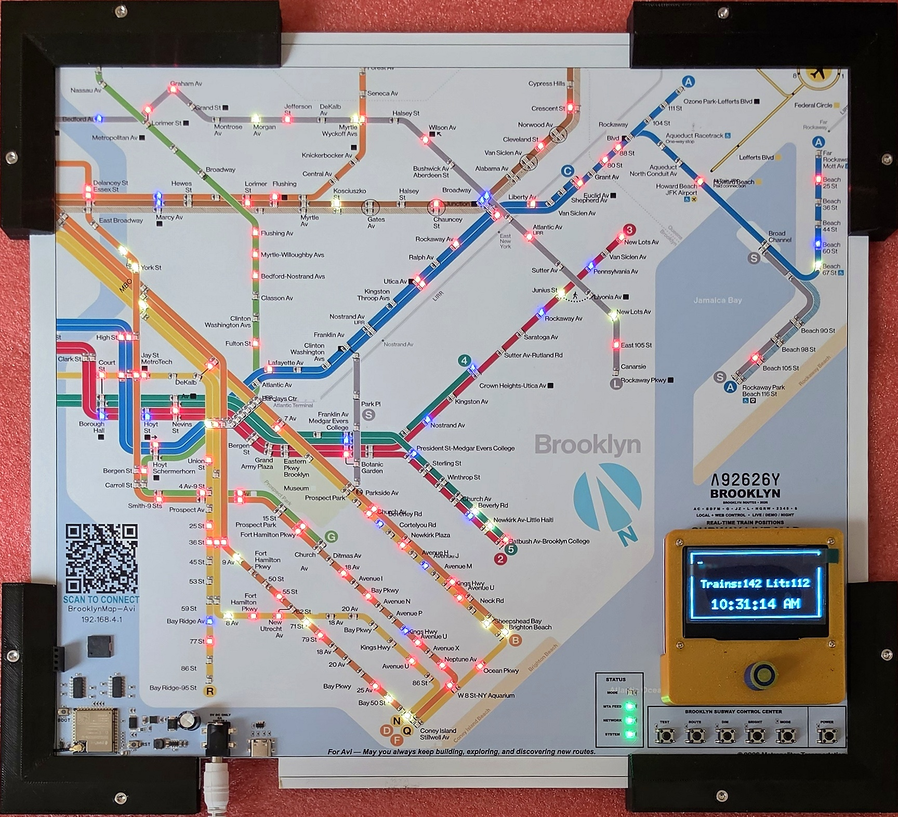

# Brooklyn Subway

**A customizable, connected subway map**

## Start Here

- **Unpacking your new map?** [Download the Unpacking & First Startup PDF](https://github.com/jgoldwein/BrooklynSubway/raw/refs/heads/main/docs/shipping/Brooklyn_Subway_Unpacking_Guide.pdf), including the startup firmware-update notice.
- **Setting up your map?** Follow [the quick start guide](docs/QUICK_START.md).
- **Want a copy to print?** [Download the one-page Quick Start PDF](https://github.com/jgoldwein/BrooklynSubway/raw/refs/heads/main/docs/shipping/Brooklyn_Subway_Quick_Start.pdf).
  Print on US Letter at **100% / Actual size**.
- **Want to learn the controls, colors and sounds?** Open
  [Brooklyn Subway Map - User Guide](docs/USER_GUIDE.md).
- **Want another live view?** Open [SubwayNow](https://www.subwaynow.app/trains). See the [comparison notes](docs/USER_GUIDE.md#compare-with-another-live-view) for why positions may differ.
- **Moving, cleaning or packing the board?** Read
  [PCB handling and care](docs/USER_GUIDE.md#handling-cleaning-and-caring-for-the-pcb),
  including the OLED magnet and frame-mounted antenna.
- **Want to print the frame, OLED case or knob?** Download the [3D-print STL files](hardware/3d-print/README.md), individually or as one ZIP.
- **Recreating the printed map?** See the [overlay preparation tool and its current calibration limits](tools/overlay/README.md).
  For the experimental automated workflow, follow [Overlay Builder installation and first build](tools/overlay/AUTOMATION.md).
- **Interested in the electronics?** Download the [Gerbers, BOM and placement files](hardware/README.md).
- **What changed?** Read the [changelog and release notes](CHANGELOG.md), directly on GitHub.
- **Looking for upgraded firmware?** See the [latest signed release](https://github.com/jgoldwein/BrooklynSubway/releases/latest).
  For an already programmed map, use **Advanced > Firmware updates** on its web page.

If something looks wrong, open **Help > Make a support report** on the map's
web page. **Send report to The Developer** (or your saved support name) opens an email draft for you to review and send.

<a href="docs/media/brooklyn-subway-photo-straightened-v2.jpg" title="Click to view the full-size photo"></a>

[Watch the 15-second video in your browser](https://jgoldwein.github.io/BrooklynSubway/#video)

The photo shows the actual working map, conventionally cropped and adjusted.

Brooklyn Subway is a connected, light-up map that brings Brooklyn's subway
trains to your wall. It uses [official MTA train reports](https://api.mta.info/#/subwayRealTimeFeeds) to show where trains
are reported and how they are moving, with colors for approaching, stopped,
leaving and uncertain locations.

The small OLED screen can show the time, date, train counts, connection details,
Brooklyn weather and personalized station service alerts. A knob and front-panel buttons control the screens and
lights. You can also change settings, get help and install signed firmware
updates from the map's web page.

Set it up with a phone and your home Wi-Fi; no special app or account is needed.
The map needs a 2.4 GHz Wi-Fi signal and the supplied barrel power adapter.
**USB-C is for programming and service, not normal power.**

Train reports arrive in batches, and some positions are estimates. Several
trains can share one light. This is a display of MTA reports, not a GPS tracker
or a guarantee of the next train's arrival.

## Make it your own

Open **Advanced > Personalization** on the map to set the recipient, short screen name, greeting, From line, scrolling credits, celebration date, display creator, support contact name and email. **The Developer** is a generic support label; replace it with the person supporting your map. The support button uses these saved details. See the [personalization guide](docs/PERSONALIZATION.md). You can also choose station alerts and enable or customize personal extras.

The guides use generic labels. The build story, photographs and historical engineering notes describe the original gift and retain its names. The setup Wi-Fi name **BrooklynMap-Avi** stays fixed to match the printed board and recovery instructions.

## Engineering: start here

This repository contains firmware and engineering records for the manufactured
Brooklyn Active Subway Map V1.1 PCB. The development-phase notes below describe
earlier stages; use the guides above for normal operation.

1. Read `PROJECT_CONTEXT.md`.
2. After a computer or session reboot, follow [`RESUME.md`](RESUME.md) before
   continuing existing work.
3. In VS Code with the official OpenAI Codex extension, open this folder.
4. Codex automatically uses the root `AGENTS.md` as project instructions.
5. First Codex prompt:

   `Read AGENTS.md and PROJECT_CONTEXT.md. Summarize the manufactured hardware constraints and do not change any files yet.`

## PlatformIO targets

- `xiao-s3`: travel/bench compiler target (default initially).
- `xiao-s3-network`: bench-only target with Wi-Fi provisioning enabled.
- `brooklyn-s3`: manufactured V1.1 PCB target.
- `brooklyn-s3-network`: manufactured PCB target with Wi-Fi provisioning and
  MTA feed polling enabled.

Phase 1 initializes only production-board controls, power status, the user
indicator, and I2C. GPIO1 LED output-enable remains LOW; no addressable LEDs
are activated automatically. After local self-checks pass, U23 flashes twice
and the passive buzzer plays four rising notes followed by a subway-style
descending ding-dong. Hold DIM
while powering on or resetting to mute the chime for that startup. The XIAO target provides serial diagnostics and
heartbeat output without initializing production PCB GPIOs. Production input
pull-ups are provided by the PCB, so front switches and rotary push are read
as active-low inputs.

Phase 2A adds a software-only 306-pixel framebuffer and the manufactured
channel/designator map. On XIAO startup, its self-test runs before a brief
status/map simulation. The production board does not illuminate LEDs during
normal startup.

The separate discrete feed-ready indicator is U23 on GPIO14 (`USER_LED`,
active HIGH). It is outside the 306 addressable LEDs. Those 306 comprise four
CH8 status LEDs and 302 addressable map LEDs; LED291 remains a normal map LED.

## Phase 2B status

Integrated production first-LED testing is described in
[`docs/PRODUCTION_LED_DIAGNOSTIC.md`](docs/PRODUCTION_LED_DIAGNOSTIC.md).
It is a manually triggered, fixed LED42 diagnostic; normal map output remains
locked. The reviewed supply is 5 V / 3 A, with a 2000 mA estimated LED budget.

The production backend uses Adafruit NeoPixel 1.12.3 for the eight WS2812
channels. Production startup initializes channel data pins, sends an all-black
frame while GPIO1 `LED_ENABLE` is LOW, and leaves outputs disarmed.
`BROOKLYN_ALLOW_PHYSICAL_LED_OUTPUT=0` prevents arming in the standard build.
The software current estimate uses a configurable 20 mA per full-scale RGB
component assumption and a 2000 mA LED firmware budget for the reviewed 5 V,
3 A supply; the estimate is not a measurement of the board LEDs and excludes
MCU/peripheral load. Physical output remains disabled pending reviewed bring-up.

Build the bench target:

```powershell
pio run -e xiao-s3
```

Build the network-enabled bench target for Wi-Fi provisioning tests:

```powershell
pio run -e xiao-s3-network
```

This does not change the default targets and is not electrically equivalent to
the manufactured PCB.

Build the production target:

```powershell
pio run -e brooklyn-s3
```

Build the network-enabled production target for the manufactured PCB:

```powershell
pio run -e brooklyn-s3-network
```

With this firmware, the user enters setup mode by holding the rotary push for
10 seconds, joins the open `BrooklynMap-Avi` Wi-Fi network, and opens
`http://192.168.4.1/` manually if the phone does not show a captive-portal
prompt. Select a visible 2.4 GHz network and enter its Wi-Fi password on the
setup page. The network-disabled `brooklyn-s3` environment remains unchanged;
do not upload either production environment until the assembled PCB has passed
the reviewed electrical bring-up checks.

The network-enabled targets check the public GitHub Releases page for a newer
stable firmware version every six hours when Wi-Fi and time synchronization
are available. An administrator must approve downloading/installing the
signed package and separately approve rebooting into it. The authenticated
`/update` page also keeps manual signed `.bkota` uploads available. A published
stable GitHub Release is required; drafts and prereleases are ignored. See
[`docs/PHASE4W_SECURE_WEB_OTA.md`](docs/PHASE4W_SECURE_WEB_OTA.md) for the
release and security workflow.

## Licensing

- Firmware/software: Apache-2.0.
- Original hardware design: CERN-OHL-P-2.0.
- Original documentation: CC-BY-4.0.
- Third-party material retains its original rights and terms; see
  [THIRD_PARTY_NOTICES.md](THIRD_PARTY_NOTICES.md).

The full license texts are in `LICENSES/`.

The production scaffold deliberately leaves all 306 map/status LED outputs disabled. LED bring-up should be a separate reviewed step after the assembled board is electrically checked.


### Brooklyn weather (private OLED preview)

The OLED Weather screen uses Open-Meteo model-based current conditions for
central Brooklyn (40.6782, -73.9442), in Fahrenheit. Data attribution:
[Open-Meteo](https://open-meteo.com/) / [CC BY 4.0](https://creativecommons.org/licenses/by/4.0/).
API details: https://open-meteo.com/en/docs . This gift/prototype uses the free
non-commercial endpoint without an API key. Weather is not a board thermometer.

Successful requests run approximately every 15 minutes; failed attempts retry
after at least one minute, only in the idle window after an
MTA cycle, through the same background worker. Certificate validation uses the
existing framework CA bundle; no insecure mode or extra TLS task is added.
A 1024-byte bounded CSV response is checked for Fahrenheit units, timestamps,
valid numbers and a complete terminated row. HTTP/1.0 weather responses without
Content-Length are accepted until close; MTA unknown-length policy is unchanged.
Existing shared PSRAM buffer is reused. Weather errors do not alter MTA counters
or map data. Previous weather remains visibly aged; after an hour it is labeled
old and after three hours the numbers are hidden. No weather is saved to NVS.

Clock/date and weather screens respect OLED POWER/quiet-hour settings. The clock
stays displayed until you turn away; weather retains the ordinary return timeout.
Both screens have a thin border. Clock also shows valid outside temperature.
Screen order ends with Lines, Clock, Weather, Station alerts, then your personalized greeting.
Alarm clock is a future feature, not included in this preview.


### MODE button: temporary line focus (private COM6 preview)

Press MODE to show one subway line, then turn the rotary knob to choose among
all 18 lines. The OLED shows that line and its mapped train/light counts. Press
MODE again to restore the current saved route selection and normal screen
browsing. The last focused line is remembered only until reboot. Focus can show
a line hidden by saved settings; it never writes or replaces those settings.
Changes saved on the web page during focus take effect when focus ends.

POWER, brightness, quiet hours, diagnostics, the TEST+ROUTE easter-egg chord,
and the ten-second rotary Wi-Fi recovery hold retain their functions. Recovery
exits focus; ROUTE exits focus and opens/toggles the normal Lines browser.
Short rotary press has no action during focus. The prior OLED page/line-browser
state resumes after MODE exits, with idle timers paused during focus. MODE
indicator LED307 is amber during focus, within existing brightness limits.

NETWORK LED251 shows green once connected/ready, red while unavailable,
and amber while connecting or synchronizing time. Setup's logical cyan state
remains separate; recovery keeps physical outputs off. Device OLED page shows
the Wi-Fi MAC address, matching the station interface displayed by UniFi.

### Startup readiness (private preview)

After safe LED initialization, only the three readiness LEDs are lit at a
4/255 cap: initially red, SYSTEM green after local checks, NETWORK amber then
green, MTA red/amber then green when a complete fresh update arrives. All map
pixels stay black until usable data. Known failure/recovery keeps GPIO1 LOW;
POWER and saved quiet/brightness settings retain priority. Readiness edges give
short1000/1500/2000Hz cues, serialized without runtime input delays. The MTA cue
also serves U23 feed-ready, avoiding a duplicate sound. Quiet hours and DIM-at-boot
mute automatic cues. See the user guides for normal operation.


## Production TLS memory

The network-enabled production build installs the SDK mbedTLS allocator hooks
before networking. TLS blocks of 4096 bytes or more prefer the existing PSRAM;
smaller blocks use internal RAM. Internal fallback and allocation failures are
counted in serial cycle diagnostics. Certificate verification remains enabled.
This uses the already pinned ESP32 framework, with no additional dependency.
See [the COM6 recovery investigation](docs/QUIET_RESUME_RECOVERY_0.2.79.md).

## [How it was made](docs/HOW_IT_WAS_MADE.md)

Read how Joel designed the circuitry with AI assistance, had the PCB made by
JLCPCB, and designed and 3D-printed the frame and OLED case.
