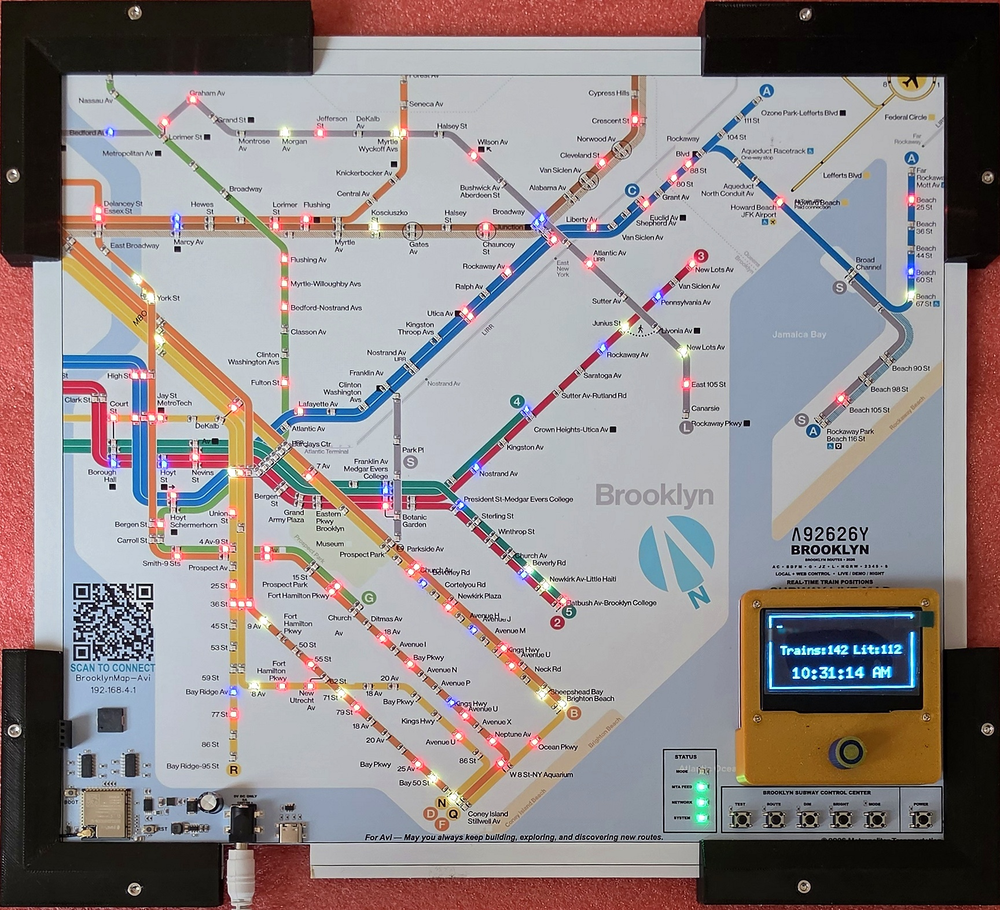

# How Brooklyn Subway was made

**A custom project for Avi Yao, created and directed by Joel W. Goldwein.**

Brooklyn Subway combines a custom circuit board, hundreds of colored lights,
a small computer, live transit data and a lot of testing. It was developed as
a personal Bar Mitzvah gift that Avi can enjoy, explore and help improve.

## The short answer: "Did you make this?"

> Yes. I designed the circuitry for this custom subway map with some AI
> assistance. I had the printed circuit board manufactured to my specifications
> through JLCPCB in Hong Kong. I also designed and 3D-printed the frame and OLED case.
> I procured and assembled all the parts and worked through the features and
> testing. The software was also developed with AI assistance and open-source
> tools. The train information comes from the Metropolitan Transportation
> Authority (MTA)'s real-time subway data feeds.

It is a collaborative kind of making: the project decisions and hands-on work,
custom 3D design and printing, professional circuit-board manufacturing, existing
electronic components, open-source libraries and AI assistance all contribute
to the result.

[Watch the working map](https://jgoldwein.github.io/BrooklynSubway/#video)
(silent, 15 seconds).

## 1. Start with the idea

The goal was a physical map that could show Brooklyn subway activity, rather
than just a picture on a phone. It also needed to be useful in a bedroom:
adjustable lights, a clock, quiet hours and simple controls.

The personal touches include a dedication to Avi, a family greeting, startup
sounds and a few hidden extras, including **Avi Yao in Morse code**.

## 2. Turn the map into electronics

**Joel designed the circuitry with AI assistance.** The design was laid out as
a **PCB**, or printed circuit board. Tiny
copper tracks connect the parts, replacing what would otherwise be a large
bundle of individual wires. The manufactured hardware design was prepared in
**EasyEDA Pro**.

The board contains **306 individually controlled RGB LEDs**, including four
status lights. RGB means each light can mix red, green and blue to make different
colors. The map LEDs are arranged along the printed subway routes. There is
also a separate small Avi-location indicator.

The lights are divided into eight electronic chains. A subway line and an LED
chain are different things: software connects each logical station or route
to the correct physical light.

**JLCPCB manufactured the custom circuit board.** Joel then brought the screen,
controls, antenna, power connection and mounting parts together into the working
map.

### Design and 3D-print the frame and case

**Joel designed and 3D-printed both the PCB frame and the OLED case.** The frame
supports the board, and the case houses the small screen. The OLED case is held
at the front of the PCB by its counter-magnet and the round magnet on the back
of the board.

These mechanical parts were part of Joel's design work alongside the circuitry,
software decisions, assembly and testing.

The [manufacturing downloads](../hardware/README.md) include the supplied
Gerbers, BOM and component placement files, with export dates and revision notes.

[Download the frame, OLED case and rotary-knob STL files](../hardware/3d-print/README.md), individually or as a single ZIP.

## 3. Give it a small computer

The main controller is an **Espressif ESP32-S3-WROOM-1U-N16R8** module. It has
Wi-Fi, 16 MB of program storage and 8 MB of extra working memory. Think of it as
a small computer dedicated to running the map.

It talks to the colored lights, reads the knob and buttons, drives the buzzer
and updates the small OLED screen. A separate antenna provides the Wi-Fi link.
The supplied 5 V barrel adapter is the normal power source; USB-C is used for
programming and service.

## 4. Turn MTA reports into lights

The map connects directly to the MTA's official subway data feeds. The data
format is called **GTFS-Realtime**: a structured set of reports that software
can read.

Each update goes through several steps:

1. Download the eight subway feed groups over Wi-Fi using secure HTTPS.
2. Read the train, trip, stop and timing information in those reports.
3. Match relevant routes and stations to the LEDs on this particular PCB.
4. Use the available evidence to classify a location as approaching, stopped,
   leaving or uncertain.
5. Draw the lights using the owner's chosen colors and brightness.

The default colors are yellow for approaching, red for stopped or recently
reported at a station, green for leaving and blue for uncertain or last-reported
positions.

This was one of the harder parts. Transit reports arrive in batches, can be
late, and do not always describe a train's movement consistently. The map uses
estimates where appropriate and shows uncertainty. It cannot provide a
continuous GPS position or prove that every red light is still a stopped train.
Several trains can also share one light.

## 5. Make it easy to live with

The firmware - the program stored on the board - was developed in **C++ using
PlatformIO and the Arduino framework**. It uses existing libraries, including
**Adafruit NeoPixel** for the LEDs and **U8g2** for the OLED.

Custom software adds the phone-friendly setup pages, password-protected
settings, screen navigation, brightness controls, quiet hours, sounds, train
monitoring and support reports. The OLED can also show time, date and Brooklyn
weather; the weather comes from Open-Meteo rather than a thermometer on the board.

The initial firmware can be installed by USB. After setup, the map can check
GitHub for releases and download signed updates over Wi-Fi. It verifies update
packages before accepting them, so software improvements do not normally need
the board to be shipped back or connected to a programming computer.

## 6. Test the physical result

Code that compiles is only the beginning. Development included checking the
power rails and polarity, running LED channel and whole-line tests, checking
colors and brightness, testing buttons and knob behavior, and observing the
OLED and the live map on actual boards.

Serial logs and the web diagnostics helped track feed failures, memory use and
restart behavior. Some problems required comparing hardware, firmware and
network conditions rather than assuming the MTA data was at fault. A secondary
board provided a way to try changes while keeping the master prototype available.

## What did it cost?

**Approximately US$150 per board** is a good estimate for this build, including
parts, PCB manufacturing, shipping, taxes and tariffs, with the printed case and power supply
also allowed for in that approximate total.

For context, Joel's case cost **less than US$1 to 3D-print**, and the power
supply was **about US$10**. These are build-cost estimates, not a selling price
or a quote for another production run. Design and software-development time
are not included.

## Where AI helped - and where people did the work

**Joel led the project and designed the circuitry with AI assistance.** He
also designed and 3D-printed the PCB frame and OLED case, chose and refined the
map's behavior, worked with the physical boards and checked the results.
**JLCPCB manufactured the PCB.** **OpenAI Codex and ChatGPT** assisted with
circuit-design work, programming, tests, troubleshooting, explanations and
documentation.

AI assistance did not manufacture the PCB, attach the screen, measure the power
rails, or replace observing the real device. Suggested changes
still needed review, tests and hardware checks. The photo above is a
conventionally edited photograph of the actual map, not an AI-generated model.

The project also depends on work by Espressif, the Arduino/PlatformIO ecosystem,
Adafruit, U8g2 contributors and other open-source developers. Transit data,
subway names, symbols and third-party artwork retain their original ownership;
they are not inventions of this project. See the
[third-party notices](../THIRD_PARTY_NOTICES.md) and
[project licensing](../README.md#licensing).

## Explore or improve it

- [Set up and use the map](AVI_QUICK_START.md).
- [Read the full user guide](AVI_USER_GUIDE.md).
- [Handle and care for the PCB](AVI_USER_GUIDE.md#handling-cleaning-and-caring-for-the-pcb).
- [Browse the project and its source code](../README.md#engineering-start-here).
- [See published firmware releases](https://github.com/jgoldwein/BrooklynSubway/releases).

The aim is a gift that keeps inviting questions: **How does it work? What could
we add? What could you build next?**
