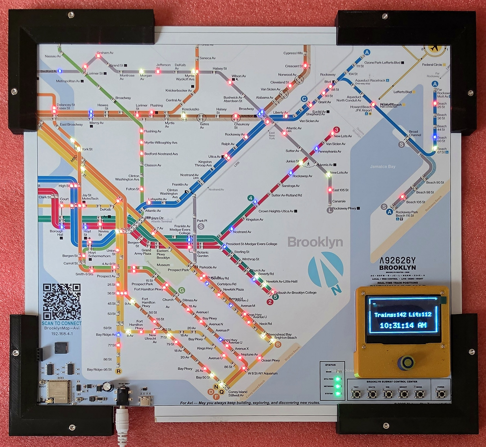
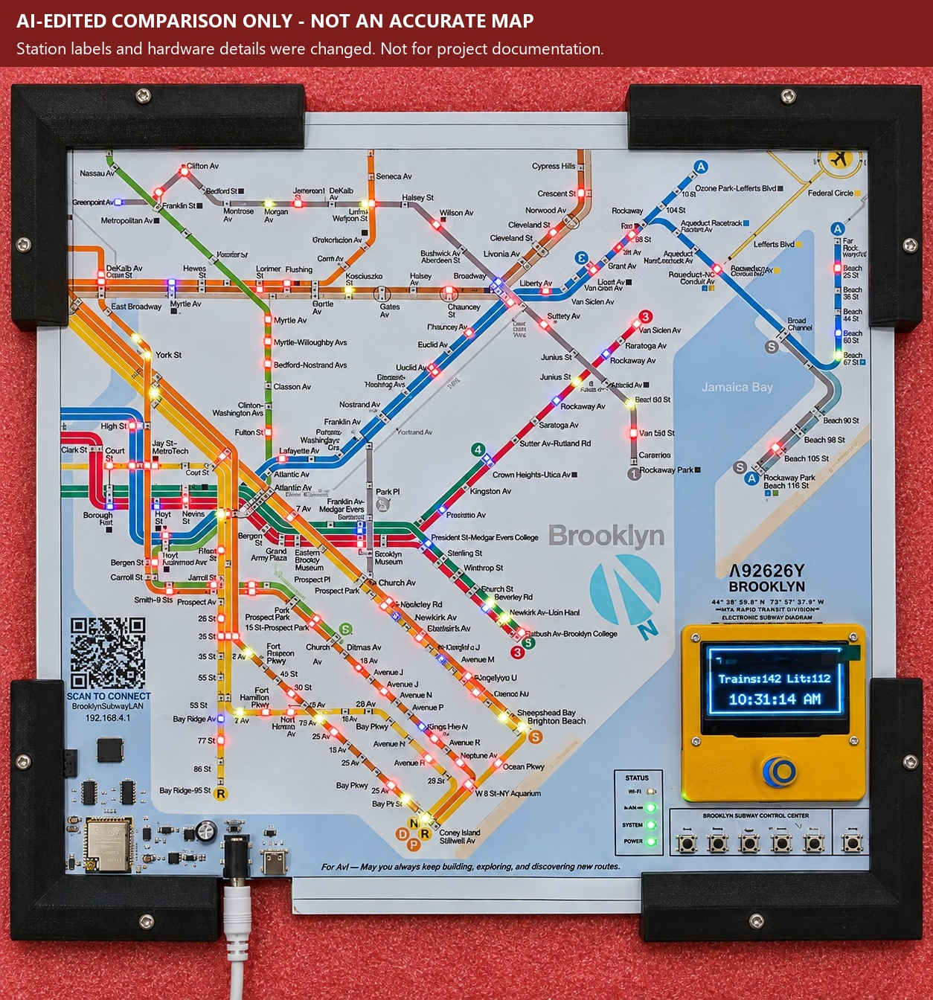

# Photo editing comparison

## Recommended: conventional edit

Cropped, gently straightened and adjusted using the actual photograph. Original
station labels, components, LEDs and OLED content are preserved without generated
replacement details.

[Open the full-size conventional photograph](conventional.jpg)

## AI edit: inaccurate comparison only

**Do not use this version as a representation of the actual board.** The AI edit
changed station labels, route details and components. It is shown here only to
explain why the conventional photograph is recommended.

[Open the AI comparison](ai-inaccurate-comparison.jpg)

The project's main README uses the selected conventional photograph. The AI
version remains here only as a clearly labeled editing comparison.
